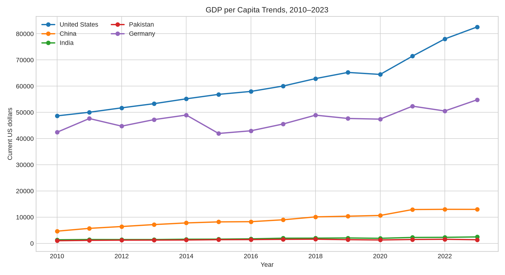
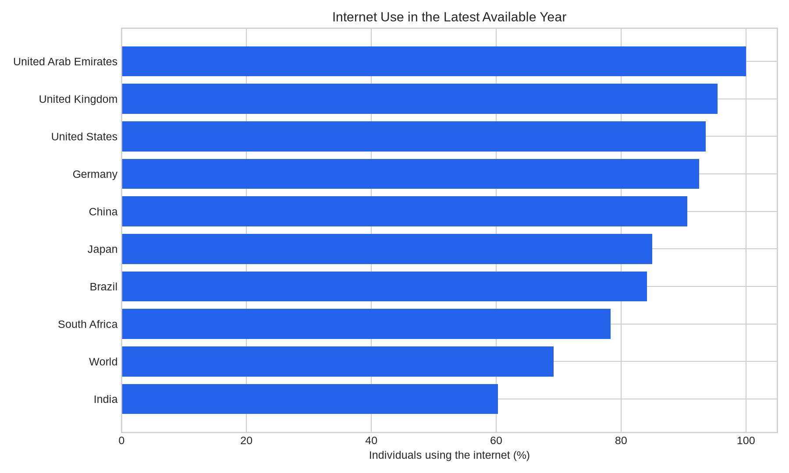

# Global Economic Insights

A reproducible international data analysis project that compares GDP per capita, inflation, unemployment, and internet adoption across selected economies. The project uses the World Bank Indicators API rather than simulated data.

## Business question

How have economic output and digital adoption changed across a representative set of advanced, emerging, and developing economies, and what limitations should decision-makers consider when comparing countries?

## Scope

The pipeline covers the world aggregate plus the United States, United Kingdom, Germany, India, Pakistan, Brazil, South Africa, United Arab Emirates, Japan, and China for 2010–2023 where observations are available.

## Outputs

- `data/world_bank_indicators.csv` — normalized indicator panel generated by the pipeline.
- `data/latest_snapshot.csv` — latest available cross-country snapshot.
- `reports/figures/gdp_per_capita_trends.png` — GDP per capita trend comparison.
- `reports/figures/internet_adoption_latest.png` — latest-year internet adoption comparison.
- `reports/insights.md` — scope and interpretation notes.





## Run locally

```bash
python -m venv .venv
source .venv/bin/activate
pip install -r requirements.txt
python src/analyze.py
```

The script downloads the latest available API observations at runtime, so results can change when the source is revised.

## Data quality and limitations

The indicators have different reporting lags. GDP per capita is reported in current US dollars and is therefore affected by exchange rates and inflation. The analysis is descriptive; it does not establish causality. Missing observations are retained as missing rather than silently imputed.

## Source

World Bank, World Development Indicators: [https://data.worldbank.org/](https://data.worldbank.org/)

## License

Code is released under the MIT License. The World Bank data remains subject to its own terms of use.
